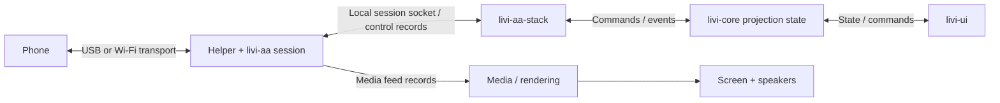
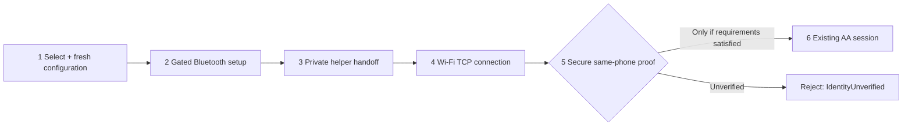
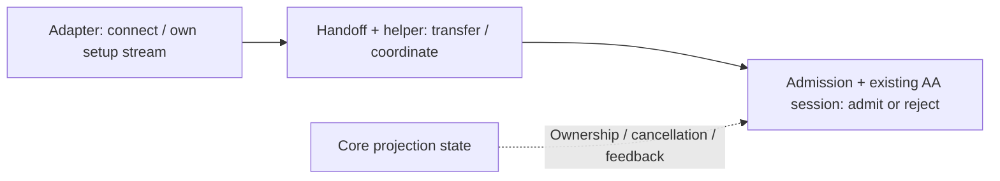
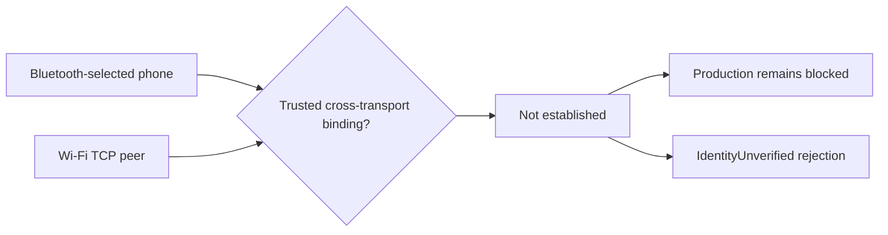

[CodeWiki](../index.md) / [Artifacts](index.md)

# LIVI: Project Overview & Android Auto Integration

[Open the 11-slide presentation](livi-android-auto-presentation.html) · [Artifacts](index.md)

## Presentation guide

The HTML deck is the primary deliverable. This page is its speaker-note and evidence appendix, not a replacement presentation.

The redesigned deck uses a navy/charcoal automotive theme, restrained electric-blue accents, original inline vector icons, a conceptual infotainment illustration, and seven visual storytelling elements: architecture, wired/wireless comparison, connection workflow, implementation timeline, component interaction, identity blocker, and roadmap. The illustration is not a screenshot, live demo, or claim of Android Auto UI fidelity.

Each slide includes concise expandable speaker notes. Use the **Speaker notes** button to open or close all notes, or open a slide's notes individually. Navigation supports arrow buttons, Right/Left, Page Down/Page Up, and Home/End when an interactive control is not focused. Slides and individual notes remain available without JavaScript.

All styling, icons, illustrations, and scripts are embedded; there are no external presentation dependencies or network requests. Browser rendering, JavaScript behavior, keyboard interaction, print pagination, and Mermaid rendering have not been executed or visually validated. A landscape print stylesheet is included; no PDF or PowerPoint export is supplied.

## Evidence legend and scope

- **Completed / Implemented:** named work is present in source. This does not mean the wireless integration is complete or correct.
- **Reviewed:** relevant source and fixtures underwent static review for the briefing. This is not runtime testing.
- **Pending Validation:** execution or physical-device evidence is absent.
- **In progress — review only:** the current presentation/evidence clarification activity, not a claim of active product or authentication implementation.
- **Proposed:** future decision gates, not committed dates or authorization.
- **Historically reported:** existing documents make claims not independently reproduced here.

These categories are not mutually exclusive: a component can be implemented, reviewed, and still pending validation.

The broader LIVI project and documented LIVI Link connectivity are separate from the incomplete direct-native macOS wireless Android Auto route. This briefing does not claim that native wireless Android Auto is operational.

Documentation only: no privileged APIs, authentication, TLS, wireless setup protocol (WPP), authorization policy, or production gates are changed. R0 authentication remains **NO-GO**. Production gates remain false and `IdentityUnverified` rejection remains mandatory. Paired inventory is UI-only, never an instruction to call `Registry::note_device`. HFP is not an established prerequisite. No Stage 5/6 work is authorized or performed.

## Slide 1

### The phone. The screen. One experience.

**Message:** LIVI brings phone projection and local media to a vehicle-style interface; native wireless groundwork exists, but secure identity remains unresolved.

**Say:** “LIVI is a head-unit application. We are exploring a separated native wireless connection path that reuses the existing projection foundation. This is a technical briefing, not a working wireless demonstration.”

**Visual:** Original infotainment concept illustration, explicitly labeled; not a product screenshot.

**Evidence:** [S1](#s1)–[S3](#s3), [S8](#s8).

## Slide 2

### Phone-powered. Head-unit simple.

**Message:** The phone supplies the driving interface; LIVI presents it and returns user input.

**Say:** “Think of the phone as the source of the experience and the head unit as its display, speakers, and interaction surface. The goal is less connection friction, without relaxing security.”

**Caveat:** Project-documented macOS wireless support uses LIVI Link. It is not proof of the newer native route. Do not repeat an unverified HFP prerequisite.

**Evidence:** [S1](#s1), [S4](#s4), [S9](#s9)–[S11](#s11).

## Slide 3

### One experience. Clear responsibilities.

**Message:** Transport, session logic, UI state, and media feeds have distinct responsibilities.

**Say:** “The helper handles connection/session work. The Android Auto stack and core coordinate protocol and state. The UI presents state and sends commands. Audio/video feeds follow a separate media path.”

**Caveat:** Simplified AA-oriented relationship view, not a full deployment map. Helper composition varies by platform.

**Evidence:** [S2](#s2)–[S4](#s4), [S9](#s9)–[S11](#s11).

## Slide 4

### Same destination. Different setup.

**Message:** Wired projection uses USB; wireless setup and projection span different transports.

**Say:** “The USB path has a watcher and existing AA session code. The wireless concept uses Bluetooth setup followed by Wi-Fi projection. The extra challenge is proving that those connections belong to the same phone.”

**Visual:** Side-by-side phone-to-screen comparison: solid USB transport versus dashed conceptual Bluetooth/Wi-Fi route.

**Caveat:** No new wired or wireless physical-device result is implied. Bluetooth is not the video transport.

**Evidence:** [S1](#s1), [S4](#s4), [S8](#s8)–[S9](#s9).

## Slide 5

### A handoff—not a second projection engine.

**Message:** Separate Bluetooth setup ownership and reuse the existing listener/session architecture.

**Say:** “A fresh attempt goes through adapter setup and private helper handoff. The target then requires secure admission before reusing the AA session. Production is already blocked before bootstrap; this is not an observed successful sequence.”

**Caveat:** Paired-device inventory is UI-only. This diagram neither chooses an authentication protocol nor authorizes changes.

**Evidence:** [S5](#s5)–[S9](#s9).

## Slide 6

### Groundwork in code. Evidence in layers.

**Message:** Configuration → adapter → handoff → reliability fixtures is a logical implementation progression, not a dated delivery history.

**Say:** “These pieces exist in source and have been statically inspected. That does not tell us that the suites pass, that stock phones interoperate, or that projection works. The same component can be implemented and reviewed while still pending validation.”

**Visual:** Four-node implementation timeline followed by three distinct evidence categories.

**Caveat:** No percentages, dates, passing totals, or full-integration completion claims. Prior Batch 2 test edits are untouched. Historical Stage 1–4 preservation remains **UNVERIFIED**; there is no valid historical baseline.

**Evidence:** [S5](#s5)–[S14](#s14); [H1](#h1)–[H3](#h3) are contextual only.

## Slide 7

### Three jobs. One accountable handoff.

**Message:** Adapter connects; handoff/helper transfers and coordinates; admission/session routes qualified connections or rejects them.

**Say:** “An owned stream means someone is responsible for closing it. Attempt identifiers stop stale work from becoming a new session. Explicit handoff makes cancellation and cleanup understandable without rebuilding projection logic.”

**Caveat:** This is a responsibility/ownership view, not proof of production progression. Same-user local IPC does not authenticate the phone. Existing downstream TLS does not solve the missing Bluetooth-to-Wi-Fi identity binding.

**Technical distinction:** TCP accepted, TLS established, AA running, decoded frame, and presented frame are separate milestones; code representing them is not proof they occurred.

**Evidence:** [S4](#s4)–[S11](#s11).

## Slide 8

### Two connections. One identity still to prove.

**Message:** “Securely verifying that the phone selected through Bluetooth is the same device establishing the Wi-Fi connection.”

**Say:** “Choosing one phone must not allow another Wi-Fi client to inherit that phone's session. Pairing and supplied labels do not establish this missing trusted link.”

**Caveat:** Optional pins, IP addresses, local-user IPC, and pairing inventory are insufficient proof. Stock compatibility and real native wireless projection remain unverified. No authentication/TLS/WPP or authorization-policy implementation is authorized.

**Evidence:** [S6](#s6)–[S9](#s9).

## Slide 9

### Review is evidence—not a test pass.

**Message:** Failure-path fixtures exist and were reviewed; **zero tests were run in this task**.

**Say:** “We have code and fixtures for cancellation, stale attempts, readiness, task ownership, and descriptor cleanup. We do not have fresh execution results or physical-device evidence from this work.”

**Limitations:** No tests, compiles, builds, formatters, app launches, sockets, or hardware connections were run. Component recreation is not process-restart proof. Review does not establish comprehensive leak freedom or expiry/restart/admitted-sentinel proof. Supervision has a two-second detection window followed by potentially unbounded cooperative joining. The prior user-approved descriptor probe retains its narrow blocking post-termination reap exception; human-readable libtest summary parsing remains fragile. Historical suite totals are not current pass evidence.

**Evidence:** [S6](#s6)–[S9](#s9), [S12](#s12)–[S14](#s14), [H3](#h3).

## Slide 10

### Advance by proof. Not by assumption.

**Message:** The roadmap uses evidence and permission gates, not invented delivery commitments.

**Say:** “The foundation is present. The current activity is evidence review and presentation—not authentication implementation. Future offline tests and feasibility investigation require separate permission. Device validation additionally depends on security requirements being satisfied.”

**Visual status lanes:**
1. **Completed / Implemented:** named groundwork present in source, not proven correct.
2. **In progress — review only:** this briefing's evidence clarification, not a broader active engineering claim.
3. **Pending — permission-gated:** offline execution, authentication feasibility, stock compatibility investigation.
4. **Pending — security-gated:** physical projection, audio/input, disconnect, and recovery validation.

**Caveat:** No dates, gate enablement, privileged API changes, or Stage 5/6 work. The roadmap is not permission to execute or weaken identity rejection. No research investigation is performed or persisted by this presentation task.

**Evidence:** [S5](#s5)–[S14](#s14) for current groundwork; future lanes are proposals subject to the stated restrictions.

## Slide 11

### Reuse the foundation. Respect the boundary. Earn the next milestone.

**Message:** A reusable source foundation exists; secure same-phone identity remains the primary blocker.

**Say:** “We can explain the architecture and ownership boundaries clearly. We cannot yet claim successful direct-native wireless Android Auto. The next step must earn evidence without bypassing the deliberate security stop.”

**Proposed path:** Offline reliability evidence → reviewed authentication feasibility → compatibility assessment → conditionally authorized physical validation.

**Evidence:** [S1](#s1), [S5](#s5)–[S14](#s14).

## Source register

These repository-relative references retain the source grounding from the prior static review. The redesign does not re-execute or newly certify the code. Symbols identify review locations without depending on unstable line numbers.

### S1

[README](../../../README.md) — purpose, platform/projection support, media capabilities, documented LIVI Link wireless context. Its HFP prerequisite statement is not adopted as verified.

### S2

[Core manifest](../../../native/crates/livi-core/Cargo.toml) — AA stack, CarPlay, link host, media, session IO, and Wi-Fi dependencies.

### S3

[UI entry point](../../../native/crates/livi-ui/src/main.rs) — core-client integration, native adapter attachment, and UI composition.

### S4

[macOS helper composition](../../../native/crates/livi-helperd/src/mac_main.rs) — `start_android_auto_network`, `native_android_auto_network_event`, USB watcher, `NativeTcp::production`. Context fields represent ownership, not cryptographic phone identity.

### S5

[Native adapter](../../../native/crates/livi-native-bluetooth/src/lib.rs) and [UI integration](../../../native/crates/livi-ui/src/native_bluetooth.rs) — main-thread adapter, owned stream events, event-loop integration, production gates false. Adapter does not own projection, WPP, helper IPC, or TCP listener logic.

### S6

[Configuration](../../../native/crates/livi-native-handoff/src/config.rs), [IPC](../../../native/crates/livi-native-handoff/src/ipc.rs), [router](../../../native/crates/livi-native-handoff/src/router.rs) — `Config::from_json`, `matches_identity`, `Channel`, `Endpoint`, readiness, descriptor adoption acknowledgment, `Router::tick`, `cancel`. Strict bounded configuration, redacted diagnostics, same-user non-root IPC, fresh attempt checks, owned cleanup. Optional identity pins are not authentication; routing has no implicit reconnect/fallback.

### S7

[Helper native handoff](../../../native/crates/livi-helperd/src/native_handoff.rs) — `serve_channel`, `Bootstrap`, generation checks, WPP handshake calls, progress, wired conflict, production rejection fixtures, worker shutdown.

### S8

[Native TCP seam](../../../native/crates/livi-helperd/src/native_tcp.rs) — `NATIVE_AUTHORIZED`, production authorization requirement, generation/runtime/deadline-bound single-use grants, `Permit::wpp_complete` rejection with `IdentityUnverified`. Does not create a TCP listener. Test-only offline bypasses are not production authorization.

### S9

[AA server](../../../native/crates/livi-aa/src/server.rs), [admission](../../../native/crates/livi-aa/src/server/admission.rs), [constants](../../../native/crates/livi-aa/src/consts.rs), [session](../../../native/crates/livi-aa/src/session.rs) — `run_with_context`, qualified routing, `supervised_shared_listener` offline support, default TCP port 5277, `session::run`. Legacy or admission path is selected, not competing listener owners. Downstream TLS/media/control processing is not same-phone proof.

### S10

[AA stack module surface](../../../native/crates/livi-aa-stack/src/lib.rs) — manager, channels, protocol, media, bridge, helper socket modules. Names are not exercised-functionality evidence.

### S11

[Core AA projection](../../../native/crates/livi-core/src/projection/aa.rs) — `on_aa`, `on_native_feedback`, `cancel_native`, `expire_native`, native exclusion in `on_aa_device`. Separate ownership/status milestones; native metadata is not normal device identity merging.

### S12

[Helper lifecycle/supervision fixtures](../../../native/crates/livi-helperd/src/native_handoff_r1_tests.rs) — registration diagnostics, fixture drop before readiness, retained join ownership, nested workers, component lifecycle scenarios. Prior Batch 2 changes are not modified or executed here.

### S13

[IPC descriptor/probe fixtures](../../../native/crates/livi-native-handoff/src/ipc/r1_batch1_tests.rs) — exact-child ownership, exact libtest selection, result classification, bounded nonblocking capture, negative fixtures, descriptor ownership permutations. Code presence is not a pass result.

### S14

[Helper fixtures](../../../native/crates/livi-helperd/src/native_handoff.rs) and [router fixtures](../../../native/crates/livi-native-handoff/src/router.rs) — fail-closed authorization, strict handshake fixtures, malformed input, cancellation, deadlines, component recreation; not physical interoperability proof.

### H1

[Existing decoupling proposal](../Specs/ArchitectureSpecs/bluetooth-decoupling.md) — design context, not proof that all proposed decoupling is complete.

### H2

[Existing hardware acceptance plan](../Specs/ArchitectureSpecs/bluetooth-hardware-acceptance.md) — planning context, not completion evidence or authorization.

### H3

[Existing Stage 4 listener report](stage4-listener-report.md) — historical self-reported validation. Totals and broad preservation assertions are not independently revalidated. Historical Stage 1–4 preservation remains unverified.

## Documentation validation boundary

Only read-only document inspection, structural/link checks where tool visibility permits, and specific pre/post SHA-256 comparisons are permitted. These do not run presentation JavaScript, render diagrams, execute product/test code, or prove hardware readiness. Preservation evidence applies only to specifically hashed files in the observed workspace during this task; it does not reconstruct a historical baseline.

The prior task encountered inconsistent shell versus direct-reader visibility for presentation files. A shell cannot validate a proposed file it cannot see; do not interpret that as a passed automated check or re-create confirmed files merely to satisfy it.
