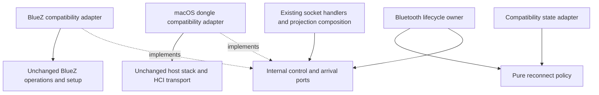

[CodeWiki](../../index.md) / [Specs](../index.md) / [Architecture Specs](index.md)

# Bluetooth Decoupling Plan

## Audit status — original proposal with current-source qualifications

This page preserves an earlier proposal, not a current implementation status report or execution authorization. The original evidence table and migration sequence below describe its inspection context; they must not be interpreted as a fresh baseline. Historical Stage 1–4 preservation is **UNVERIFIED**, and no valid historical baseline is available.

Current static review establishes the following differences:

| Current source evidence | Qualification to the original proposal |
| --- | --- |
| [Linux composition](../../../../native/crates/livi-helperd/src/linux_main.rs), `serve`; [Linux owner](../../../../native/crates/livi-helperd/src/bluetooth_linux.rs), `Owner`; [lifecycle](../../../../native/crates/livi-runtime/src/bluetooth/lifecycle.rs), `supervise` | Lifecycle extraction already exists. Composition invokes `reconnect::run_with_wifi`; the old E1 excerpt is not current, and retry supervision is delegated rather than wholly in `serve`. Presence does not prove behavior preservation. |
| [Shared socket](../../../../native/crates/livi-runtime/src/shared_sock.rs), `handle`; [projection socket](../../../../native/crates/livi-runtime/src/livi_sock.rs), `serve` and `handle` | Shared command routing now uses `bt.execute`; E4's direct-call excerpt is historical. Request-time versus accept-time backend snapshots remain distinct in the reviewed handlers. |
| [Reconnect adapter](../../../../native/crates/livi-runtime/src/reconnect.rs), `run_with_wifi`, `paging_allowed` | `paging_allowed` is `connected || wifi_ready`. Disconnected Linux paging therefore waits for Wi-Fi; connected stale handling does not. The original Wi-Fi-independent paging requirement is not established. |
| [Pure policy](../../../../native/crates/livi-runtime/src/bluetooth/policy.rs), `Reconnect::decide` and `hands_free_retains_the_original_stale_disconnect_and_wake_rules` | `hands_free` and `hfp_linked` do not prevent stale disconnection. A connected observation without `link_active` can reach `Disconnect` after the stale interval. The HFP-survival requirement remains unresolved, not verified. The named test was read, not run. |
| [Dongle adapter](../../../../native/crates/livi-helperd/src/bt_dongle.rs), `page` | Reconnect decisions delegate to policy; disconnected dongle paging is suppressed during a call. Do not infer Linux/dongle parity or a general HFP stale exemption. |

The proposal's HFP-survival and Wi-Fi-independent paging criteria below are retained as **unexecuted acceptance goals**, not descriptions of current behavior. Resolving these discrepancies requires a separately authorized product decision; this audit does not change code, weaken criteria, or restart an ended batch. HFP is not a proven Android Auto prerequisite.

**Standing safety boundary:** all nine frozen source files remain uneditable, including test modules; the two approved handoff/IPC test files are immutable. The verifier is hash-only, never executable. No tests, builds, formatters, apps/browsers, socket or hardware connections, restores, authentication/TLS/WPP, authorization-policy, or elevated API changes are authorized. Production gates stay false, `IdentityUnverified` remains mandatory, paired inventory is UI-only and never `Registry::note_device`, and Stage 5/6 is out of scope. These restrictions override the historical migration and lab proposals.

## Overview

Decouple Bluetooth lifecycle, device control, and reconnect policy from projection orchestration without changing any elevated privileged APIs. This is the original proposal, not a claim that no implementation exists; consult the current-source qualifications above. No runtime, configuration, permission, or transport changes are part of this document change.

The recommended scope is an incremental, in-process refactor. Keep the existing helper process and low-level Bluetooth implementations. Introduce internal interfaces around them so projection and socket request handling do not need to manipulate BlueZ connections or depend on a complete helper-state object.

Success means the orchestration and policy can be tested with fake backends, Bluetooth failures remain isolated from unrelated services, and all existing external contracts and privilege-sensitive operations retain their behavior.

## Context

### Original inspected structure — historical evidence

All source paths below are relative to the repository root. Excerpts identify the original coupling or preservation requirement, not the entire implementation. This table is retained for design provenance, not certified as current; the audit status above identifies confirmed changes and unresolved requirements.

| Evidence | Verified source and function/type | Relevant excerpt | Architectural implication |
| --- | --- | --- | --- |
| E1 | `native/crates/livi-helperd/src/linux_main.rs`, `serve` | `tasks.spawn(reconnect::run(conn.clone(), adapter.clone(), state.clone()));` | Linux composition owns radio lifecycle, reconnect, profile registration, and projection dispatch in one function. |
| E2 | `native/crates/livi-helperd/src/linux_main.rs`, `serve` retry loop | `"[helperd] Bluetooth unavailable ({e}); independent services carry on, retrying"` | Failure isolation already exists and must be preserved, not presented as new functionality. Socket servers, wired watchers, and AA network startup occur before the adapter wait. |
| E3 | `native/crates/livi-runtime/src/livi_sock.rs`, `Bluez` and `serve` | `pub bus: zbus::Connection,` and `bluez: watch::Receiver<Option<Bluez>>,` | The projection socket layer receives concrete backend state. It snapshots that state when accepting a connection. |
| E4 | `native/crates/livi-runtime/src/shared_sock.rs`, `handle` | `Some(bt) => bluez_verb(&bt.bus, verb, arg, &bt.adapter).await,` | Shared command routing directly knows the BlueZ implementation. |
| E5 | `native/crates/livi-runtime/src/bt.rs`, `on_cable` | `let cabled = state.carkit_claims(mac);` | Backend-adjacent code depends on projection state and constructs a projection-specific callback. |
| E6 | `native/crates/livi-runtime/src/reconnect.rs`, `run` | `let targets = state.reconnect_targets();` and `if state.link_active(&mac) {` | Reconnect policy takes the broad `HelperState` rather than narrow policy inputs. |
| E7 | `native/crates/livi-helperd/src/bt_dongle.rs`, `page` | `if profiles.hfp.in_call() { continue; }` | Dongle paging has a call-aware behavior not present in the Linux reconnect loop; consolidation must not silently erase platform differences. |
| E8 | `native/crates/livi-helperd/src/aa.rs`, `watch` and `watch_dongle` | `UnboundedReceiver<livi_runtime::bt::IncomingConn>` and `UnboundedReceiver<crate::bt_dongle::Arrival>` | The same AA handshake is fed by two backend-specific arrival types. |
| E9 | `native/crates/livi-runtime/src/bluetoothd.rs`, Linux `setup` | `.args(["restart", "bluetooth"])` | Bluetooth setup edits system configuration and can restart the system daemon. This implementation is protected. |
| E10 | `native/crates/livi-link-host/src/bt.rs`, `tunnel`; `native/crates/livi-btd/src/linux.rs`, `claim` | `.open(VHCI)` and `libc::SOCK_RAW | libc::SOCK_CLOEXEC` | The host tunnel and dongle daemon perform low-level device operations. Neither needs redesign for this refactor. |
| E11 | `native/crates/livi-runtime/src/privileged.rs`, `write_root_file` | `require_root()?;` | Root-only installation/file operations are a separate protected API surface. |
| E12 | `native/crates/livi-core/src/devices.rs`, `shared` | `LineSock::new(SHARED_SOCK, "shared sock")` | Existing core consumers already use a socket boundary; changing their protocol is unnecessary. |
| E13 | `native/crates/livi-runtime/src/hfp.rs`, `Hfp::set_events`; `sco.rs`, `call` | `events: crate::livi_sock::Broadcaster` and `link: &livi_hfp::sco::Link` | Hands-free and audio bridge integration can remain intact while lifecycle and projection dispatch are separated. |
| E14 | `native/crates/livi-helperd/src/mac_main.rs`, `run` | `let no_bluez = tokio::sync::watch::channel(None).1;` | macOS currently exposes no BlueZ device-control backend through the shared socket. A common interface must not accidentally enable new commands there. |

`native/crates/livi-runtime/src/bluetooth.rs` already supplies adapter-availability helpers. In particular, `changed` waits indefinitely when a fixed adapter's producer is gone rather than spinning:

```rust
if adapters.changed().await.is_err() {
    std::future::pending::<()>().await;
}
```

Existing coverage includes adapter availability tests in that module; unavailable and recovery cases in `native/crates/livi-runtime/tests/shared_sock.rs`; socket availability without Bluetooth in `tests/livi_sock.rs`; and private-D-Bus reconnect cases in `tests/reconnect.rs`. The recovery and reconnect D-Bus cases are explicitly ignored by default.

### Investigation boundary

The control/composition sources above were read, including command dispatch, state access, HFP/SCO integration, host tunnel framing, and daemon controller claiming. The host-stack entry points in `livi-bt-host/src/host.rs` and the daemon host queue in `livi-btd/src/host.rs` were also inspected. This is not a complete audit of the Bluetooth protocol stack, projection protocols, installers, or every UI consumer. Lower-level HCI/L2CAP/RFCOMM/SDP and HFP implementations and full iAP2/AA stacks were not traced end to end. Those implementations are out of the proposed edit scope. No hardware or runtime behavior was measured, and existing tests were inspected, not executed.

## Decision

Create a logical Bluetooth subsystem within the existing process before considering any crate extraction. Separate:

1. **Control:** typed internal commands and backend-independent availability.
2. **Lifecycle:** adapter acquisition, registration ownership, retry, and teardown.
3. **Policy:** reconnect decisions based on narrow input snapshots.
4. **Consumers:** projection bootstrap, hands-free integration, and media-event translation.

Keep privilege-sensitive implementations where they are. Use thin internal compatibility adapters; do not move root operations into a new crate or introduce another privileged endpoint.

The target dependency direction is projection/composition to internal contracts, with backend adapters implementing those contracts. Contracts and pure policy must not depend on projection bootstrap, Wi-Fi readiness, `HelperState`, or `zbus`.

### Proposed dependency flow



Arrows show dependency or delegation, not new IPC. All proposed seams remain inside the existing helper/runtime process. The lifecycle owner invokes existing backend operations in their current order; it does not acquire additional privileges. Consumer callbacks keep Wi-Fi readiness, authentication, and cable arbitration outside the pure modules.

## Components

All new paths in this section are proposed.

| Component | Proposed location | Responsibility and boundary |
| --- | --- | --- |
| Internal contracts | `native/crates/livi-runtime/src/bluetooth/control.rs` | Typed requests, backend-independent readiness metadata, and a mockable command handle. No socket binding, root operations, or concrete BlueZ handle. |
| Pure reconnect policy | `native/crates/livi-runtime/src/bluetooth/policy.rs` | Compute next actions from targets, link/profile state, backend policy settings, and an injected clock. No device I/O. |
| Module exports | Existing `native/crates/livi-runtime/src/bluetooth.rs` | Add submodule declarations while preserving `available` and `changed` signatures and semantics. |
| Linux lifecycle owner | `native/crates/livi-helperd/src/bluetooth_linux.rs` | Extract the Bluetooth attempt/retry/health/cleanup orchestration from `linux_main::serve`, preserving calls into existing low-level functions. |
| Consumer composition | Existing `linux_main.rs`, `mac_main.rs`, and `aa.rs` | Keep authentication, Wi-Fi configuration, wired precedence, and protocol startup outside backend control and pure policy. |
| Compatibility adapters | Existing `shared_sock.rs`, `livi_sock.rs`, `reconnect.rs`, and `bt_dongle.rs` | Translate internal operations to the existing implementation. Preserve public entry points and external behavior. |
| Existing backend implementations | Existing `bt.rs`, `bluetoothd.rs`, `livi-link-host/src/bt.rs`, `livi-btd`, `livi-bt-host`, and `livi-hfp` | Reuse unchanged privilege-sensitive/device/protocol operations; no transport rewrite. |

Do not introduce a new crate initially. The existing workspace already separates the daemon and host stack; extracting runtime policy and orchestration is the immediate benefit. Revisit crate extraction only after dependency tests demonstrate a stable boundary.

## Interfaces

### Internal proposal

Use a channel-backed command handle or a generic async port rather than exposing `zbus::Connection` in new consumer code. Keep the operation set limited to existing behavior:

- List paired devices.
- Connect or disconnect a named profile.
- Connect or disconnect a device.
- Remove a paired device.
- Observe readiness and local adapter identity.

Keep playback status and profile arrivals as separate ports rather than making one oversized Bluetooth trait. An arrival envelope should carry peer identity, local identity, and an owned stream. Normalize Linux file descriptors and dongle Unix streams at adapter edges before calling the existing generic AA `handshake`.

At first, wrap existing public functions rather than replacing their signatures. For `shared_sock`, preserve `serve` and keep `bluez_verb`, `device_call`, `remove_device`, and `list_paired` as the operation implementation. For `livi_sock`, preserve `serve`, `Bluez`, `LiviSockConfig`, and the existing callback precedence. Add private translation points in `handle` rather than changing privileged service APIs.

The internal facade is not a new public daemon API. It must not provide arbitrary D-Bus method calls, arbitrary shell execution, or root file writes.

### Snapshot timing is part of compatibility

The two existing socket handlers deliberately need separate compatibility adapters. Do not make a shared command queue implicitly resolve every request against the latest backend.

| Verified source and excerpt | Required adapter behavior | Characterization case |
| --- | --- | --- |
| `livi_sock::serve`: `let bluez = bluez.borrow().clone();` immediately after `listener.accept().await?` | Pin the backend snapshot at server acceptance, before reading the request header. | Coordinate acceptance, change availability, then send the header; the accepted connection retains the original snapshot. |
| `shared_sock::handle`: `let line = read_line(&mut stream).await?;` followed by `let bluetooth = bluetooth.borrow().clone();` | Resolve the backend after receiving the complete command line, then pin it for that operation. | Accept an idle connection while unavailable, publish a backend, then send the command; it uses the newly available backend. Also test loss before command completion. |
| `livi_sock::handle`, `disconnect`: `Some(bluez) => match device_disconnect(...)` and only `None => match cfg.disconnect.clone()` | Use the configured disconnect callback only when the accepted snapshot is absent, not when a BlueZ call fails. | With both routes configured, verify that BlueZ errors do not trigger the callback; without BlueZ, verify callback success and errors. |

Use fake ports or a private session bus and explicit synchronization barriers for these tests, not sleeps that assume the server has accepted a connection. Internal generation identifiers are diagnostic metadata only; they must not add retries, reroute an accepted operation, or change legacy errors.

### Frozen external and elevated contracts

| Surface | Preservation requirement |
| --- | --- |
| `livi-runtime/src/privileged.rs` | No changes to signatures, root checks, destinations, modes, sudoers validation, or installation behavior. |
| `livi-helperd/src/main.rs` switches and Linux `run_install_*`, `run_wifi_ap_*`, `run_bt_tunnel` entry points | Keep names, arguments, dispatch, and exit behavior. Adding a private module declaration must not alter CLI routing. |
| `bluetoothd::setup` and its configuration helpers | Keep configuration paths/content rules, plugin selection, class restoration, restart conditions, and call ordering. |
| `bt.rs` BlueZ operations | Keep public signatures, D-Bus interfaces/object paths, UUIDs, channels, authentication/trust/authorization settings, adapter filtering, rfkill behavior, retry bounds, and restoration logic. Leave this file unchanged in the initial refactor. |
| Shared socket | Keep `/tmp/livi-shared.sock`, permissions, newline framing, existing verbs, UUID defaults, JSON keys, errors, paired-device ordering, and availability behavior. |
| Projection socket | Keep `/tmp/cp-bt.sock`, permissions, framing, all verbs, disconnect fallback precedence, reconnect target normalization, and authentication/tunnel behavior. |
| macOS shared commands | Keep current unavailable behavior for Bluetooth device-control verbs; do not expose new pairing/control functionality through the facade. |
| HCI tunnel and dongle daemon | No changes to `livi-link-host/src/bt.rs`, `livi-btd`, port selection, framing, packet handling, controller ownership, or reconnect/takeover behavior. |
| Hands-free and SCO | No changes to existing HFP/SCO APIs, microphone socket permissions/path, codec/packet behavior, or audio feed formats. |
| Deployment/security | No new services, capabilities, sudo rules, D-Bus policy, permission changes, or privilege elevation. |

“Unchanged” covers behavior and security properties, not just signatures. Where internal handler routing changes, differential contract tests must prove equivalence. A phase requiring a protected change must be redesigned or separately authorized; it is not a reason to relax this constraint.

## Data Model

Proposed internal models should be minimal:

| Model | Suggested fields | Compatibility rule |
| --- | --- | --- |
| Adapter snapshot | readiness, adapter identifier, local address, internal generation | Do not publish new wire fields or replace legacy public types. Keep connection handles private to adapters. |
| Profile arrival | peer, local address, service kind, owned stream | Transfer ownership once; preserve Linux/dongle address byte order and existing stream behavior. |
| Reconnect target | MAC and optional service UUID | Preserve target order, uppercase normalization, nullable UUID semantics, and default handling. |
| Reconnect observations | ACL connection, active bootstrap/link, HFP profile state, call state | Do not equate ACL, HFP, and projection readiness. |
| Policy settings | intervals, attempt threshold, stale threshold, backend-specific behavior | Initially reproduce each backend's current behavior; do not force false parity. |
| Paired device | existing response fields | Preserve `mac`, `name`, `connected`, `trusted`, `class`, and `path`, including sort and escaping behavior. |

Persisted device records and Bluetooth key storage do not migrate. In `bt_dongle.rs`, `keys_path` currently resolves the key location; leave its value and storage implementation unchanged. Internal typed errors must map to existing external responses, not replace them with a new public error schema.

## Cross-Cutting Concerns

### Ownership and failure isolation

The lifecycle owner acquires one adapter/daemon generation and releases its registrations on exit. Preserve current selected-adapter filtering, service-owner health checks, timeout values, retry cadence, `Held` restoration, and shutdown behavior. Clear availability and the current media-player slot on the same paths and in the same order as today.

Distinguish owner-scoped tasks from already-dispatched session tasks. The current Linux `JoinSet` contains reconnect and AA watcher tasks, while session work is also spawned separately. Do not broaden cancellation to established sessions merely because orchestration moved. Characterize these lifetimes before introducing a new task owner.

Keep wired CarPlay, AA USB, AA network serving, shared control, and available identity-based Bonjour startup independent of adapter acquisition. Preserve the special fallback that waits for a Bluetooth address only when needed for identity. Missing Wi-Fi readiness must not block radio paging; Wi-Fi checks remain in protocol bootstrap.

### State and domain boundaries

Retain `HelperState` as the existing compatibility store initially. Pass narrow read-only callbacks or snapshots into policy rather than relocating all of its fields. Cable arbitration remains in composition: use the existing `carkit_claims` semantics, including unidentified wired phones, then invoke a disconnect port. Leave the legacy `bt::on_cable` helper intact; new composition need not depend on it directly.

Hands-free remains useful without projection. Preserve the HFP stale-link exception and dongle in-call paging suppression. Preserve backend differences around profile state and default wake services until separately specified.

### Security and observability

Do not log pairing keys, authentication material, Wi-Fi passwords, certificates, or full traffic payloads. Any new diagnostics should be limited to lifecycle state and backend failures. No privileged commands or real adapter mutations are required for unit or fake-D-Bus tests.

## Alternatives Considered

| Alternative | Decision |
| --- | --- |
| A new standalone privileged Bluetooth service | Reject for this work: requires deployment/IPC/security changes and risks violating the API constraint. |
| Move all Bluetooth-related code into one new crate | Defer: mixes protocol, privileged I/O, policy, and projection concerns without first defining stable seams. |
| Make BlueZ the cross-platform interface | Reject: leaks Linux-specific types and does not match the existing macOS dongle path. |
| Refactor Linux only and ignore macOS | Reject as the final outcome: risks divergent policy and arrival contracts. Migrate Linux first, then adapt macOS explicitly. |
| Reimplement HCI, RFCOMM, HFP, or pairing | Reject: unrelated to the coupling problem and unnecessarily risky. |
| Leave everything unchanged | Safe but leaves orchestration and policy difficult to test independently. |

## Migration Strategy

Deliver the phases in order, each as a small independently reviewable change. Ownership below names required roles, not assigned people.

| Phase | Owner role | Exact scope and insertion points | Completion gate |
| --- | --- | --- | --- |
| 0. Characterize and freeze | Runtime maintainer + security reviewer | Historical proposal: extend external socket/reconnect characterization tests only after separate permission; never edit frozen `bt.rs`, including its teardown tests, or either immutable approved test file. Capture authorized current hashes and fixtures without claiming a reconstructed historical baseline. | Characterization and execution remain permission-gated; no golden-case pass or historical preservation is established by this document. |
| 1. Add internal contracts | Runtime maintainer | Add `bluetooth/control.rs` and `bluetooth/policy.rs`; add declarations after the imports in existing `bluetooth.rs`. Start with a fake control implementation. Add private translation in `shared_sock::handle` and `livi_sock::handle`, keeping existing public entry points and operation bodies. | Existing callers compile unchanged; fake backend drives routing; contract fixtures remain identical. No concrete backend types appear in new pure contracts. |
| 2. Extract Linux lifecycle | Helper maintainer | Add `livi-helperd/src/bluetooth_linux.rs` and its Linux-gated declaration in `main.rs`. Extract the `bluetooth` attempt closure, outer retry loop, active ownership, and `release_bluetooth` from `linux_main::serve`. Inject consumer callbacks/dependencies; leave non-Bluetooth service startup in `serve`. | Startup without an adapter, loss/recovery, daemon-owner change, fixed-adapter channel closure, and shutdown match existing behavior. Privileged setup and backend call sequence remain intact. |
| 3. Isolate policy inputs | Runtime + helper maintainers | In `reconnect::run`, delegate decision computation to pure policy using narrow views over current state. Adapt `bt_dongle::page` similarly, preserving its busy set, call suppression, profile checks, and blocking-I/O boundaries. Leave state mutation and protected device operations in adapters. | Clock-driven tests reproduce round-robin order, 1-second fast interval, 15-attempt threshold, 30-second slow retry, 10-second stale handling, HFP exceptions, and target removal. Record deliberate backend differences. |
| 4. Separate arrivals and projection | Helper maintainer | In `aa::watch`, `aa::over_bluez`, and `aa::watch_dongle`, translate incoming resources into the internal envelope before invoking the existing `handshake`. In Linux CarPlay dispatch and `mac_main::wireless_sessions`, consume arrivals through adapters while retaining authentication, identity, AP checks, and cable arbitration in composition. Adapt `bt_dongle::take`/`hand` only at the delivery boundary. | AA and CarPlay bootstrap behavior, FD ownership, local-address order, wired precedence, and HFP dispatch remain unchanged on each platform. |
| 5. Consolidate and guard — not authorized | Runtime maintainer + QA | Retained original proposal only. No Stage 5/6 work, execution, or rollback is permitted by the current task. | No completion claim; requires separately authorized scope and evidence. |

Do not use a runtime feature flag or expose a second daemon endpoint simply to stage the migration. Phase ordering and reversible commits provide the rollout boundary.

### Validation matrix

| Level | Required cases |
| --- | --- |
| Pure unit tests | Fake backend for control; paused/injected clock for policy; target normalization; no targets; unavailable adapter; closed fixed-adapter channel; generation metadata; HFP without projection; backend-specific call suppression. |
| Socket contracts | All existing Bluetooth and unrelated verbs, subscription continuity, default and explicit UUIDs, missing MAC, paired sorting, removal, disconnect fallback, unavailable errors, legacy JSON and modes. Compare old/new fixtures on the same platform. |
| Private D-Bus | Existing ignored recovery/reconnect/teardown cases plus owner replacement, selected-adapter rejection, restoration, and repeated recovery without socket rebinding. Serialize tests sharing `org.bluez`. |
| Lifecycle integration | Independent services remain responsive while the adapter is absent; wired/network sessions survive Bluetooth retries; no duplicate registrations; player-slot replacement; shutdown during acquisition/registration/health waits; no task spin. |
| Cross-platform | Linux with local BlueZ, Linux dongle/VHCI, macOS dongle path, and macOS without selected dongle. Preserve current unsupported control operations. |
| Hardware acceptance | Pair/unpair and reconnect on supported platforms; CarPlay and AA wireless bootstrap; wired priority; HFP call without projection; SCO mic/downlink; dongle unplug/replug; BlueZ restart and normal exit restoration. |
| Privilege audit | Compare frozen hashes/diffs, public signatures, CLI fixtures, socket permissions, D-Bus profile options, setup behavior, transport framing, and deployment files. No new capabilities or root-access paths. |

The original proposal called for runtime/helper/host/HFP suites, helper compilation, and ignored private-D-Bus socket/reconnect/teardown cases on authorized Linux/macOS runners. Executable recipes are retired here because current restrictions prohibit those runs. Nothing was run by this audit. macOS source review cannot establish Linux-gated runtime behavior; a default suite result would not by itself prove ignored cases ran.

### Evidence required at each implementation gate

Record the platform, exact command, selected test names, passed/failed/ignored counts, and protected-surface comparison for each phase. Mark unavailable hardware or private-D-Bus checks as **not run**, never as passed.

One existing test needs particular care: `native/crates/livi-runtime/tests/livi_sock.rs`, `certificate_sign_and_subscribe`, contains `Err(_) => return` when `zbus::Connection::system().await` fails. A green run can therefore omit its assertions. In phase 0, add a hardware-independent equivalent using the existing `MockAuth` and `no_bluez` helpers, and record the original test's environment prerequisite. Do not require a system bus or real controller for the new equivalent.

If future teardown coverage is separately authorized, use external integration tests in permitted files. Frozen `bt.rs` is never editable, including its `#[cfg(test)]` module; no checksum exception is permitted. The approved `native_handoff_r1_tests.rs` and `ipc/r1_batch1_tests.rs` also remain immutable.

For this planning task, verify only document structure, navigation, source references, and unchanged source/script contents. Runtime tests, private-D-Bus tests, and hardware acceptance remain implementation-phase gates; no privileged setup or adapter mutation should be executed to validate a documentation-only change.

### Rollout and rollback

Merge one phase only after its gate passes. Keep each change reversible and preserve command fixtures across phases. Use a known-good binary for comparison on the same platform and configuration; do not run competing helpers against one controller or socket.

The original proposal envisioned reverting the latest refactor and redeploying a prior helper through the existing deployment process. This audit authorizes no Git operation, restore, old application inspection, deployment, or launch. No key, configuration, device-record, or protocol migration is intended; introducing one would require scope reconsideration and explicit permission.

## Risks and Mitigations

| Risk | Mitigation |
| --- | --- |
| “Cleanup” alters privileged behavior | Freeze protected implementations and compare exact signatures/options/command behavior; security review is a release gate. |
| Common policy accidentally changes backend semantics | Model differences explicitly and compare action traces before switching adapters to shared policy. |
| New facade changes snapshot timing or fallback precedence | Characterize current socket accept/request timing and disconnect behavior; preserve it in compatibility wrappers. |
| Lifecycle extraction terminates unrelated sessions | Classify task lifetimes first; retain existing ownership/cancellation semantics. |
| Stream conversion leaks or duplicates ownership | Transfer owned descriptors once; test closure and failed dispatch paths. |
| HFP becomes tied to projection lifetime | Keep profile/call observations separate; test hands-free beyond the stale timeout without projection. |
| Hardware-only regressions escape fake tests | Require Linux local/dongle and macOS dongle acceptance before completing the migration. |
| Boundary is still too broad after extraction | Enforce no `zbus`, Wi-Fi, projection, or `HelperState` dependencies in pure contracts/policy; defer crate extraction until this holds. |

### Definition of done

The subsystem has mockable internal control and policy boundaries, lifecycle orchestration is separated from projection startup, both supported platform paths use the intended seams, and unrelated services retain their existing failure isolation. Every frozen contract passes its comparison gate, all applicable native/D-Bus/hardware checks have recorded results, and no elevated privileged API, privilege-sensitive implementation, deployment permission, or external protocol has changed.

Open scheduling items are maintainer assignment and access to the Linux/macOS hardware matrix. They do not block agreeing on this design, but they are required before declaring the implementation complete.
